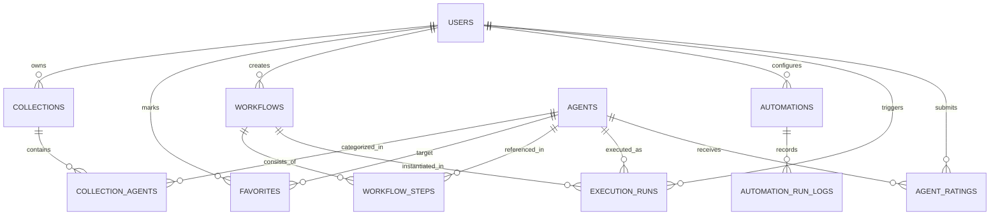

# Backend Database Schema Specification

This document details the relational database schema design for the **iloveAgents** backend persistence layer, designed for high concurrency, multi-tenant isolation, auditability, and horizontal scalability.

---

## 1. Entity-Relationship Overview

---

## 2. Table Specifications

### 2.1 `users`
Core user identity and authentication profile.

| Column | Type | Constraints | Description |
| :--- | :--- | :--- | :--- |
| `id` | `UUID` | `PRIMARY KEY, DEFAULT gen_random_uuid()` | Unique user identifier |
| `email` | `VARCHAR(255)` | `UNIQUE, NOT NULL` | Verified user email |
| `username` | `VARCHAR(64)` | `UNIQUE, NOT NULL` | Public handle / slug |
| `display_name` | `VARCHAR(128)` | `NULLABLE` | Display name |
| `avatar_url` | `TEXT` | `NULLABLE` | URL to profile picture |
| `created_at` | `TIMESTAMPTZ` | `NOT NULL, DEFAULT now()` | Registration timestamp |
| `updated_at` | `TIMESTAMPTZ` | `NOT NULL, DEFAULT now()` | Profile update timestamp |

**Indexes**:
- `CREATE UNIQUE INDEX idx_users_email ON users(email);`
- `CREATE UNIQUE INDEX idx_users_username ON users(username);`

---

### 2.2 `agents`
Registered AI agents available across the platform.

| Column | Type | Constraints | Description |
| :--- | :--- | :--- | :--- |
| `id` | `VARCHAR(128)` | `PRIMARY KEY` | Kebab-case unique agent identifier |
| `name` | `VARCHAR(128)` | `NOT NULL` | User-facing agent name |
| `description` | `TEXT` | `NOT NULL` | One-sentence summary |
| `category` | `VARCHAR(64)` | `NOT NULL` | Domain category (e.g., Engineering, Productivity) |
| `icon` | `VARCHAR(64)` | `NOT NULL` | Lucide icon identifier |
| `provider` | `VARCHAR(32)` | `NOT NULL, DEFAULT 'any'` | Default or allowed provider |
| `default_model` | `VARCHAR(64)` | `NOT NULL` | Default LLM model identifier |
| `inputs_schema` | `JSONB` | `NOT NULL, DEFAULT '[]'::jsonb` | Declarative input fields configuration |
| `example_inputs` | `JSONB` | `NOT NULL, DEFAULT '{}'::jsonb` | Sample input pre-fill data |
| `system_prompt` | `TEXT` | `NOT NULL` | Agent system instructions |
| `is_active` | `BOOLEAN` | `NOT NULL, DEFAULT true` | Availability flag |
| `created_at` | `TIMESTAMPTZ` | `NOT NULL, DEFAULT now()` | Inception timestamp |
| `updated_at` | `TIMESTAMPTZ` | `NOT NULL, DEFAULT now()` | Last configuration update |

**Indexes**:
- `CREATE INDEX idx_agents_category ON agents(category);`
- `CREATE INDEX idx_agents_is_active ON agents(is_active);`

---

### 2.3 `collections` & `collection_agents`
User-curated sets of agents.

#### `collections`
| Column | Type | Constraints | Description |
| :--- | :--- | :--- | :--- |
| `id` | `UUID` | `PRIMARY KEY, DEFAULT gen_random_uuid()` | Unique collection ID |
| `user_id` | `UUID` | `REFERENCES users(id) ON DELETE CASCADE` | Creator user ID |
| `name` | `VARCHAR(128)` | `NOT NULL` | Collection name |
| `description` | `TEXT` | `NULLABLE` | Optional summary |
| `is_public` | `BOOLEAN` | `NOT NULL, DEFAULT false` | Shareable flag |
| `created_at` | `TIMESTAMPTZ` | `NOT NULL, DEFAULT now()` | Created timestamp |

#### `collection_agents`
| Column | Type | Constraints | Description |
| :--- | :--- | :--- | :--- |
| `collection_id` | `UUID` | `REFERENCES collections(id) ON DELETE CASCADE` | Parent collection |
| `agent_id` | `VARCHAR(128)` | `REFERENCES agents(id) ON DELETE CASCADE` | Member agent |
| `position` | `INTEGER` | `NOT NULL, DEFAULT 0` | Ordering index |
| `added_at` | `TIMESTAMPTZ` | `NOT NULL, DEFAULT now()` | Added timestamp |

**Constraints**:
- `PRIMARY KEY (collection_id, agent_id)`

---

### 2.4 `workflows` & `workflow_steps`
Multi-agent chained pipelines.

#### `workflows`
| Column | Type | Constraints | Description |
| :--- | :--- | :--- | :--- |
| `id` | `UUID` | `PRIMARY KEY, DEFAULT gen_random_uuid()` | Unique workflow ID |
| `user_id` | `UUID` | `REFERENCES users(id) ON DELETE CASCADE` | Owner user ID |
| `title` | `VARCHAR(255)` | `NOT NULL` | Pipeline title |
| `description` | `TEXT` | `NULLABLE` | Pipeline documentation |
| `is_published` | `BOOLEAN` | `NOT NULL, DEFAULT false` | Public library flag |
| `created_at` | `TIMESTAMPTZ` | `NOT NULL, DEFAULT now()` | Creation timestamp |
| `updated_at` | `TIMESTAMPTZ` | `NOT NULL, DEFAULT now()` | Update timestamp |

#### `workflow_steps`
| Column | Type | Constraints | Description |
| :--- | :--- | :--- | :--- |
| `id` | `UUID` | `PRIMARY KEY, DEFAULT gen_random_uuid()` | Step ID |
| `workflow_id` | `UUID` | `REFERENCES workflows(id) ON DELETE CASCADE` | Workflow link |
| `step_order` | `INTEGER` | `NOT NULL` | Execution sequence (1, 2, 3...) |
| `agent_id` | `VARCHAR(128)` | `REFERENCES agents(id)` | Agent executed in this step |
| `input_mapping` | `JSONB` | `NOT NULL, DEFAULT '{}'::jsonb` | Parameter mapping & previous step interpolation |
| `custom_instructions`| `TEXT` | `NULLABLE` | Step-specific prompt override |

---

### 2.5 `execution_runs`
Audit and history log for individual agent runs and workflow executions.

| Column | Type | Constraints | Description |
| :--- | :--- | :--- | :--- |
| `id` | `UUID` | `PRIMARY KEY, DEFAULT gen_random_uuid()` | Unique execution run ID |
| `user_id` | `UUID` | `NULLABLE, REFERENCES users(id) ON DELETE SET NULL` | User who triggered execution |
| `agent_id` | `VARCHAR(128)` | `NULLABLE, REFERENCES agents(id)` | Associated agent |
| `workflow_id` | `UUID` | `NULLABLE, REFERENCES workflows(id)` | Associated workflow (if pipeline) |
| `provider` | `VARCHAR(32)` | `NOT NULL` | Execution provider (openai, anthropic, gemini) |
| `model` | `VARCHAR(64)` | `NOT NULL` | LLM model invoked |
| `input_payload` | `JSONB` | `NOT NULL` | User input parameters |
| `output_content`| `TEXT` | `NULLABLE` | LLM response |
| `status` | `VARCHAR(32)` | `NOT NULL` | `pending`, `streaming`, `success`, `failed`, `cancelled` |
| `latency_ms` | `INTEGER` | `NULLABLE` | Total execution duration |
| `prompt_tokens` | `INTEGER` | `NOT NULL, DEFAULT 0` | Input token count |
| `completion_tokens` | `INTEGER` | `NOT NULL, DEFAULT 0` | Output token count |
| `estimated_cost`| `DECIMAL(10, 6)` | `NOT NULL, DEFAULT 0.000000` | Financial cost estimate in USD |
| `error_message` | `TEXT` | `NULLABLE` | Error stack / reason if failed |
| `created_at` | `TIMESTAMPTZ` | `NOT NULL, DEFAULT now()` | Timestamp of invocation |

**Indexes**:
- `CREATE INDEX idx_execution_runs_user_id ON execution_runs(user_id);`
- `CREATE INDEX idx_execution_runs_agent_id ON execution_runs(agent_id);`
- `CREATE INDEX idx_execution_runs_created_at ON execution_runs(created_at DESC);`

---

### 2.6 `automations` & `automation_run_logs`
Scheduled background cron jobs.

#### `automations`
| Column | Type | Constraints | Description |
| :--- | :--- | :--- | :--- |
| `id` | `UUID` | `PRIMARY KEY, DEFAULT gen_random_uuid()` | Unique automation ID |
| `user_id` | `UUID` | `REFERENCES users(id) ON DELETE CASCADE` | Creator user |
| `name` | `VARCHAR(128)` | `NOT NULL` | Automation label |
| `agent_id` | `VARCHAR(128)` | `REFERENCES agents(id)` | Agent to run |
| `cron_expression`| `VARCHAR(64)` | `NOT NULL` | Standard 5-field cron spec |
| `input_payload` | `JSONB` | `NOT NULL` | Pre-configured input parameters |
| `delivery_target`| `VARCHAR(32)` | `NOT NULL, DEFAULT 'email'` | Delivery channel (`email`, `webhook`) |
| `recipient_config`| `JSONB` | `NOT NULL` | Channel config (e.g. email address, webhook URL) |
| `is_enabled` | `BOOLEAN` | `NOT NULL, DEFAULT true` | Active flag |
| `last_run_at` | `TIMESTAMPTZ` | `NULLABLE` | Last scheduled run |
| `next_run_at` | `TIMESTAMPTZ` | `NOT NULL` | Next execution target |

---

## 3. Data Integrity & Row-Level Security (RLS)

1. **Isolation by `user_id`**:
   - `collections`, `workflows`, and `automations` enforce RLS so that users can only read, update, and delete their own records unless `is_public` is true.
2. **Atomic Step Ordering**:
   - `workflow_steps` includes a unique constraint `UNIQUE (workflow_id, step_order)` to prevent race conditions during pipeline reordering.
3. **Partitioning Strategy for `execution_runs`**:
   - As execution history scales past tens of millions of records, `execution_runs` should be range-partitioned by month on `created_at` (`PARTITION BY RANGE (created_at)`).
